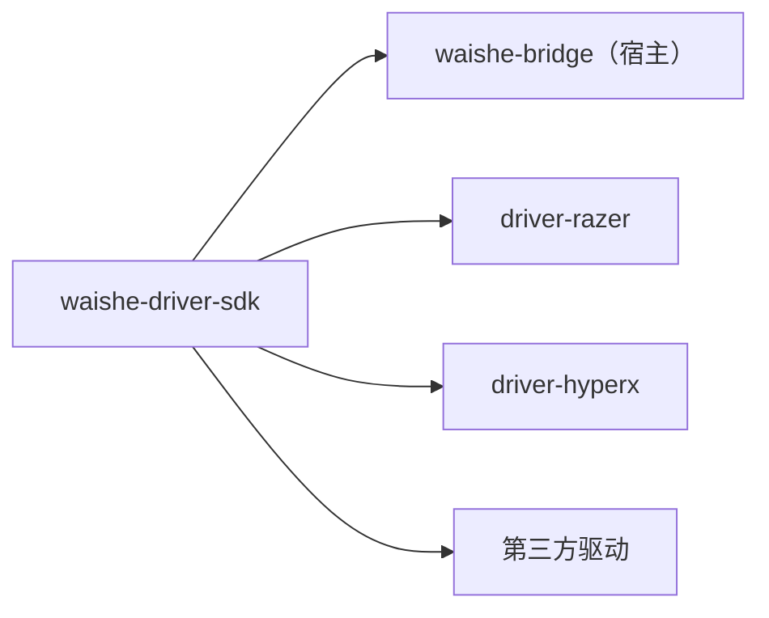

# waishe-driver-sdk

WaiShe 驱动的接口规范、能力模型，以及驱动开发与测试工具。

**当前阶段：规范草案。尚无可用的库和工具。** 接口形态取决于 `waishe` 仓库的决策记录 0003（驱动插件运行时），M0 技术验证后定稿。

## 这个仓库定义什么

WaiShe 里的“驱动”是用户态的协议适配器：它知道某个品牌或协议族的设备怎样收发报文，并把这些能力翻译成统一的能力模型。它不是操作系统驱动。

Bridge 和所有驱动都依赖本仓库，彼此之间不直接依赖：

## 文档

| 文档 | 内容 | 状态 |
| --- | --- | --- |
| [驱动接口](docs/driver-interface.md) | 驱动包结构、清单、匹配规则、宿主与驱动之间的调用、生命周期、错误模型、驱动须遵守的规则 | 草案 0.1 |
| [能力模型](docs/capabilities.md) | 标准能力目录、值类型、约束、读数状态、写入结果、如何新增能力 | 草案 0.1 |

## 计划内容

| 内容 | 里程碑 |
| --- | --- |
| 接口定义文件与版本化规则 | M1 |
| 驱动侧库：接口绑定、常用的报文与校验工具 | M1 |
| 回放测试工具：用录制的报文序列离线测试驱动 | M1 |
| 驱动模板与最小示例 | M1 |
| 打包工具：生成驱动包并校验清单 | M2 |
| 接口 1.0 冻结 | M3 |

## 版本

驱动接口独立版本化。1.0 之前允许不兼容变更，每次变更都升版本号；Bridge 与驱动各自声明所支持的接口版本，不匹配时 Bridge 拒绝加载并给出原因。

## 许可证

[MIT](LICENSE-MIT) 或 [Apache-2.0](LICENSE-APACHE) 双许可，使用者任选其一。本仓库保持宽松许可证，以免限制驱动作者的许可证选择。

## 相关

- 项目总览、需求与架构：`waishe` 仓库。
- 贡献流程：`.github` 仓库的 `CONTRIBUTING.md`。
