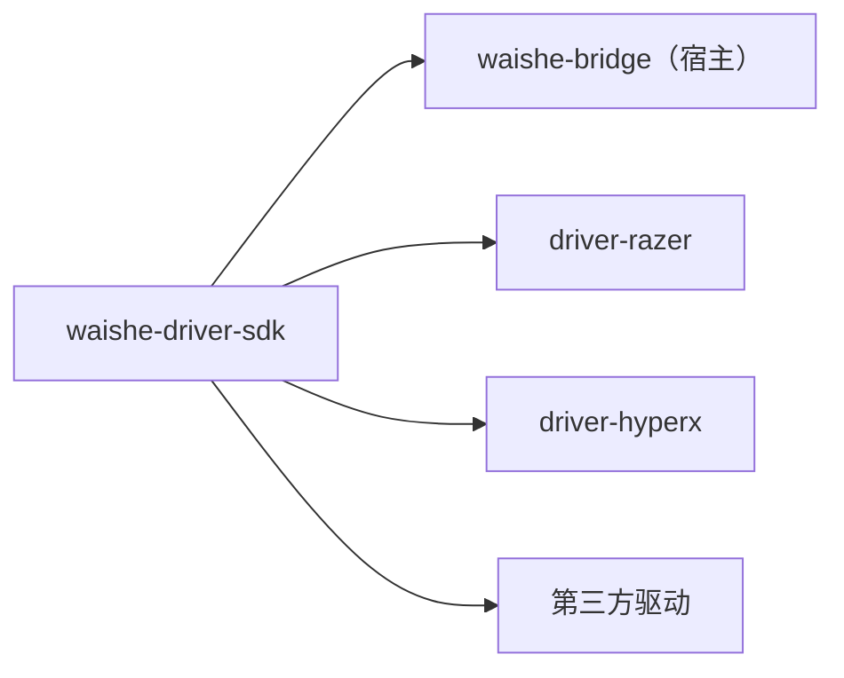

# waishe-driver-sdk

WaiShe 驱动的接口规范、能力模型，以及驱动开发与测试工具。

**当前阶段：ABI 0.1 已实现，供 M1 使用；1.0 冻结前仍可能有不兼容变更。** 驱动是 WebAssembly 核心模块，由 Bridge 内嵌的 wasmi 运行（`waishe` 仓库决策记录 0003）。

## 组成

| crate | 用途 | 使用者 |
| --- | --- | --- |
| `waishe-driver-types` | ABI 常量、能力模型、清单与设备表类型 | 驱动与宿主 |
| `waishe-driver` | `Driver` trait、HID 访问、`export_driver!` 宏 | 驱动作者 |
| `waishe-driver-host` | 在 wasmi 沙箱中运行驱动，限额与 HID 注入 | Bridge |
| `waishe-driver-replay` | 用脚本化的 HID 交互离线测试驱动 | 驱动作者 |
| `waishe-driver-dev` | 不经 Bridge，在真实设备上运行驱动 | 驱动作者 |

驱动仓库以 Git 依赖引用本仓库。在本地联调时，可在所有仓库的共同父目录放一个 `.cargo/config.toml`，用 `[patch."https://github.com/WaiShe-Project/waishe-driver-sdk"]` 指向本地检出。

## 这个仓库定义什么

WaiShe 里的“驱动”是用户态的协议适配器：它知道某个品牌或协议族的设备怎样收发报文，并把这些能力翻译成统一的能力模型。它不是操作系统驱动。

Bridge 和所有驱动都依赖本仓库，彼此之间不直接依赖：

## 文档

| 文档 | 内容 | 状态 |
| --- | --- | --- |
| [驱动接口](docs/driver-interface.md) | 编写驱动、驱动包、清单、ABI、输入报告、限额、规则、测试工具 | ABI 0.1，已实现 |
| [能力模型](docs/capabilities.md) | 标准能力目录、值类型、约束、读数状态、写入结果、如何新增能力 | 0.1，已实现 |

## 计划内容

| 内容 | 里程碑 |
| --- | --- |
| 驱动包打包工具：生成 `.wsdrv` 并校验清单 | M1（Bridge 旁加载需要） |
| 驱动模板 | M2 |
| ABI 1.0 冻结 | M3 |

## 版本

驱动接口独立版本化。1.0 之前允许不兼容变更，每次变更都升版本号；Bridge 与驱动各自声明所支持的接口版本，不匹配时 Bridge 拒绝加载并给出原因。

## 许可证

[MIT](LICENSE-MIT) 或 [Apache-2.0](LICENSE-APACHE) 双许可，使用者任选其一。本仓库保持宽松许可证，以免限制驱动作者的许可证选择。

## 相关

- 项目总览、需求与架构：`waishe` 仓库。
- 贡献流程：`.github` 仓库的 `CONTRIBUTING.md`。
