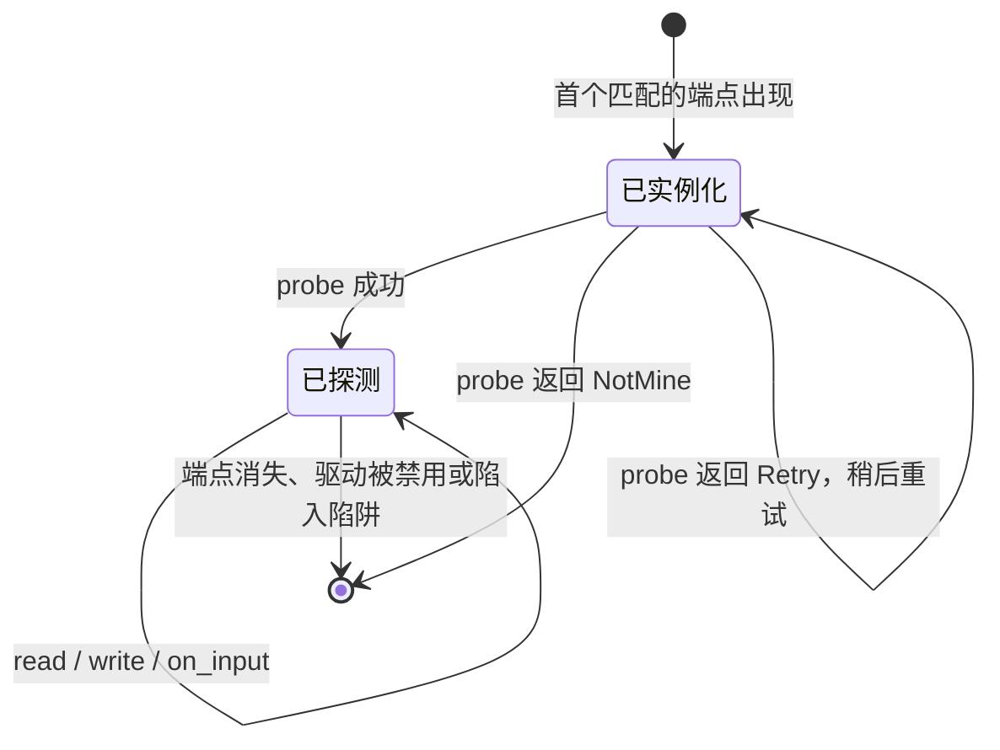

# 驱动接口

| 项 | 内容 |
| --- | --- |
| 版本 | ABI 0.1（已实现） |
| 日期 | 2026-11-14 |
| 形态 | WebAssembly 核心模块，由 wasmi 运行，不使用组件模型（`waishe` 仓库决策记录 0003） |
| 实现 | `crates/types`（共享类型与常量）、`crates/driver`（驱动侧）、`crates/host`（宿主侧） |

## 1. 职责划分

| 事项 | 宿主（Bridge） | 驱动 |
| --- | --- | --- |
| 枚举设备、监听插拔 | ✔ | |
| 打开和关闭 HID 接口 | ✔ | |
| 判断某个端点是不是自己能处理的设备 | 按匹配规则初筛 | 探测确认 |
| 协议报文的构造与解析 | | ✔ |
| 调度轮询、排队、超时与重试策略 | ✔ | 协议内的重试（例如设备回“忙”） |
| 判定历史值、缓存、持久化 | ✔ | |
| 界面、通知、联网 | ✔ | |

驱动是无界面的协议状态机：宿主把端点交给它，它通过宿主提供的少数几个函数收发报文，返回结构化的结果。

## 2. 编写驱动

```rust
use waishe_driver::{Driver, EndpointInfo, ProbeResult, ProbeError, /* ... */};

struct MyDriver { control: waishe_driver::hid::Handle }

impl Driver for MyDriver {
    fn probe(ep: &EndpointInfo) -> Result<(Self, ProbeResult), ProbeError> { /* ... */ }
    fn describe(&self) -> Vec<CapabilityDescriptor> { /* ... */ }
    fn read(&mut self, capability: &str) -> Result<Value, ReadError> { /* ... */ }
    // write、on_input 可选
}

waishe_driver::export_driver!(MyDriver);
```

构建：`crate-type = ["cdylib", "rlib"]`，`cargo build --release --target wasm32-unknown-unknown`。`rlib` 使纯解析代码可以在本机做单元测试。

完整的例子：`driver-hyperx`（只读、主动上报）与 `driver-razer`（读写、协议内重试）。

## 3. 驱动包

驱动包是一个 zip 归档，扩展名暂定 `.wsdrv`：

```text
razer-0.1.0.wsdrv
├── driver.toml       清单
├── devices.toml      设备表
├── driver.wasm       驱动代码
├── LICENSE
└── PROVENANCE.md     协议来源记录
```

### 3.1 清单 `driver.toml`

```toml
[driver]
id = "razer"                         # Registry 内唯一，小写字母、数字、连字符
name = "Razer"
version = "0.1.0"                    # 语义化版本
api = "0.1"                          # 驱动 ABI 版本
license = "AGPL-3.0-or-later"        # SPDX 表达式
repository = "https://github.com/WaiShe-Project/driver-razer"
description = "Razer 鼠标"

# 匹配规则：宿主只把命中的 HID 集合交给驱动。所有出现的字段都须相符
[[match]]
vendor_id = 0x1532
product_ids = [0x00B6, 0x00B7, 0x00C2]
interface_number = 0                 # 可选
usage_page = 0x0001                  # 可选
usage = 0x0002                       # 可选
```

规则越具体越好：驱动能拿到的句柄范围就是规则命中的集合。

### 3.2 设备表 `devices.toml`

型号之间的差异优先写在设备表里，而不是代码分支里。验证等级按 设备 × 连接方式 × 能力 记录：

```toml
[[device]]
model = "deathadder-v3-pro"          # 与 ProbeResult.model 一致
name = "Razer DeathAdder V3 Pro"
brand = "Razer"
kind = "mouse"

  [[device.endpoint]]
  transport = "receiver"             # wired / receiver / bluetooth
  product_id = 0x00B7

  [[device.verification]]
  capability = "mouse.dpi"
  transport = "receiver"
  level = "verified"                 # verified / simulated / inferred / broken
  firmware = "2.2"                   # verified 时必填
  verified_by = "..."                # verified 时必填
  verified_on = "2026-11-14"         # verified 时必填
  note = "..."                       # 可选
```

## 4. 生命周期



- **每个端点一个实例，各有独立的存储与内存上限。** 驱动可以在 `self` 中保存会话状态，但不能假设它跨越重连而保留。
- **`probe` 只读。** 可以发查询命令（例如读序列号），不得改变设备设置。接收器在线但设备不在线时，`probe` 应当成功，设备的不在线体现在 `link.state`。
- **陷阱即淘汰。** 驱动陷入陷阱（panic、燃料耗尽、超时）后，宿主丢弃该实例，重新实例化并探测。

## 5. ABI

常量定义在 `waishe-driver-types` 的 `abi` 模块。驱动侧库与宿主侧库已实现全部细节，驱动作者通常不需要直接接触本节。

### 5.1 宿主提供的函数（导入模块 `waishe`）

| 函数 | 签名 | 返回 |
| --- | --- | --- |
| `hid_send_feature` | `(handle, ptr, len) -> i32` | 0 或负的状态码。`ptr[0]` 为报告 ID |
| `hid_get_feature` | `(handle, ptr, len) -> i32` | 读到的字节数或负的状态码。调用前把 `ptr[0]` 设为报告 ID |
| `hid_write` | `(handle, ptr, len) -> i32` | 写出的字节数或负的状态码 |
| `hid_read` | `(handle, ptr, len, timeout_ms) -> i32` | 读到的字节数；超时为 0；负的状态码 |
| `sleep_ms` | `(ms)` | 宿主限制最长时间 |
| `now_ms` | `() -> i64` | 实例创建以来的单调毫秒数 |
| `log` | `(level, ptr, len)` | 0 错误、1 警告、2 信息、3 调试。宿主负责限长 |

状态码：`-1` 句柄未授予、`-2` 设备断开、`-3` I/O 错误、`-4` 忙、`-5` 缓冲区无效。

没有其他函数。驱动不能访问文件、网络、环境变量或其他进程，也不能枚举或打开设备。

### 5.2 驱动导出的函数

| 函数 | 签名 | 输入 | 输出 |
| --- | --- | --- | --- |
| `waishe_abi` | `() -> i32` | — | `主版本 << 16 \| 次版本` |
| `waishe_alloc` | `(len) -> ptr` | — | 供下一次调用写入输入的缓冲区 |
| `waishe_probe` | `(ptr, len) -> i64` | `EndpointInfo` | `Result<ProbeResult, ProbeError>` |
| `waishe_describe` | `() -> i64` | — | `Vec<CapabilityDescriptor>` |
| `waishe_read` | `(ptr, len) -> i64` | 能力 ID `String` | `Result<Value, ReadError>` |
| `waishe_write` | `(ptr, len) -> i64` | `(String, Value)` | `Result<WriteOutcome, WriteError>` |
| `waishe_on_input` | `(handle, ptr, len) -> i64` | 原始报告字节 | `Vec<CapabilityEvent>` |

- 结构化数据用 [postcard](https://docs.rs/postcard) 编码，类型定义见 `waishe-driver-types`。
- 返回值 `i64` 为 `指针 << 32 | 长度`，指向驱动内存中的输出，在下一次调用前有效。
- 宿主先调用 `waishe_alloc(len)` 得到指针，把输入写入该处，再调用目标函数。

### 5.3 输入报告

驱动在 `ProbeResult.listen` 中列出要监听的句柄。宿主持续读取这些句柄上的输入报告，对每一份调用 `on_input`。

**输入报告会送达打开该接口的所有句柄，包括厂商软件的句柄**（M0 实测）。因此：

- `on_input` 会收到其他程序的查询应答，驱动应当照常解析（它们也是有效的设备状态），并忽略无法识别的报告。
- 驱动在 `read` 内部用 `hid.read` 等待应答时，可能先读到无关报告，必须按请求匹配应答并跳过其余的。
- 宿主会把驱动在一次调用期间读到的所有报告，在调用结束后再交给 `on_input` 一次，避免这期间的主动上报丢失。

### 5.4 限额

由宿主设定，默认值：

| 项 | 默认 |
| --- | --- |
| 线性内存 | 16 MiB |
| 每次调用的燃料 | 20 亿（M0 实测约每毫秒 670 万） |
| 每次调用的墙钟时间 | 10 秒，包括阻塞在宿主函数中的时间 |
| 单次休眠 | 1 秒 |
| 单次读超时 | 5 秒 |
| 单个报告缓冲区 | 4096 字节 |

超出任一限额即陷入陷阱。

## 6. 驱动必须遵守的规则

1. **不发送固件升级、引导加载程序、出厂校准类命令。** 包含这类命令的驱动不会被 Registry 收录。
2. **写命令必须有出处。** 每条写命令须能对应到 `PROVENANCE.md` 中登记的公开实现或抓包证据。
3. **不把读不到的值编造成数值。** 设备不在线时返回 `Unavailable`，见能力模型第 4 节。
4. **协议允许时写后回读**，返回 `Applied` 及回读值；值没有生效时返回错误。
5. **不假设独占设备。** 见 5.3。
6. **在限额内完成每次调用。**
7. **日志中不输出序列号和完整报文。**

## 7. 测试

| 层次 | 工具 | 对应验证等级 |
| --- | --- | --- |
| 单元测试 | 纯解析函数在本机运行 | — |
| 回放测试 | `waishe-driver-replay`：真实的 `.wasm` 在真实宿主中运行，对照脚本化的 HID 交互 | `simulated` |
| 实机调试 | `waishe-driver-dev`：不经 Bridge，直接在真实设备上运行驱动 | — |
| 实机验证 | 按设备验证计划逐项执行并记录 | `verified` |

回放脚本格式见 `crates/replay/src/lib.rs` 的文档注释。脚本提交前须去除序列号等可识别信息。

`waishe-driver-dev` 的用法：

```text
waishe-driver-dev <含 driver.toml 的目录> <driver.wasm> probe
waishe-driver-dev <目录> <driver.wasm> read [能力...]
waishe-driver-dev <目录> <driver.wasm> write <能力> <值>
waishe-driver-dev <目录> <driver.wasm> listen <秒>
```

## 8. 版本

- 清单中的 `api` 声明驱动所用的 ABI 版本，驱动的 `waishe_abi` 导出须与之一致。
- 1.0 之前：次版本号不同即视为不兼容，宿主拒绝加载。
- 1.0 之后：同一主版本内向后兼容；宿主可同时支持多个主版本。
