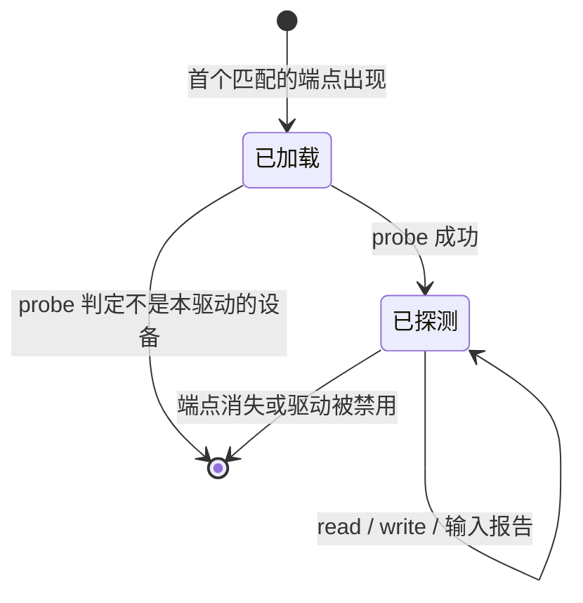

# 驱动接口

| 项 | 内容 |
| --- | --- |
| 版本 | 草案 0.1，非规范 |
| 日期 | 2026-11-14 |
| 前提 | 驱动为 WebAssembly 核心模块，由 Bridge 内嵌的 wasmi 运行，不使用组件模型（`waishe` 仓库决策记录 0003，已接受） |

## 1. 职责划分

| 事项 | 宿主（Bridge） | 驱动 |
| --- | --- | --- |
| 枚举设备、监听插拔 | ✔ | |
| 打开和关闭 HID 接口 | ✔ | |
| 判断某个端点是不是自己能处理的设备 | 按匹配规则初筛 | 探测确认 |
| 协议报文的构造与解析 | | ✔ |
| 调度轮询、排队、超时与重试策略 | ✔ | |
| 判定历史值、缓存、持久化 | ✔ | |
| 界面、通知、联网 | ✔ | |

驱动是无界面的协议状态机：宿主把端点交给它，它通过宿主提供的少数几个函数收发报文，返回结构化的结果。

## 2. 驱动包

驱动包是一个归档文件，扩展名暂定 `.wsdrv`：

```text
razer-0.1.0.wsdrv
├── driver.toml       清单
├── devices.toml      设备表
├── driver.wasm       驱动代码
├── LICENSE
└── PROVENANCE.md     协议来源记录
```

### 2.1 清单

```toml
[driver]
id = "razer"                         # Registry 内唯一
name = "Razer"
version = "0.1.0"                    # 语义化版本
api = "0.1"                          # 所用驱动接口版本
license = "AGPL-3.0-or-later"        # SPDX 标识符
repository = "https://github.com/WaiShe-Project/driver-razer"
description = "Razer 鼠标"

# 匹配规则：宿主只会把命中的接口交给驱动
[[match]]
vendor_id = 0x1532
product_ids = [0x00B6, 0x00B7, 0x00C2, 0x00C3]
```

匹配规则可用的条件：厂商 ID、产品 ID 列表、接口号、用途页、用途。条件越具体越好，驱动拿到的句柄范围由它决定。

### 2.2 设备表

型号之间的差异优先写在设备表里，而不是代码分支里。

```toml
[[device]]
model = "deathadder-v3-pro"
name = "Razer DeathAdder V3 Pro"
brand = "Razer"
kind = "mouse"

  [[device.endpoint]]
  transport = "wired"
  product_id = 0x00B6

  [[device.endpoint]]
  transport = "receiver"
  product_id = 0x00B7

  # 验证等级按 设备 × 连接方式 × 能力 记录
  [[device.verification]]
  capability = "battery.level"
  transport = "receiver"
  level = "inferred"                 # verified / simulated / inferred / broken
  # verified 时必须填写以下字段
  # firmware = "..."
  # verified_by = "..."
  # verified_on = "2026-..."
```

上例中的产品 ID 取自 openrazer 的头文件，验证等级如实写作 `inferred`，实机验证后再改。

## 3. 生命周期



- **每个端点一个驱动实例。** 实例之间不共享内存。驱动可以在实例内保存会话状态，但不能假设它跨越重连而保留。
- **`probe` 只读且幂等。** 探测阶段不得改变设备的任何设置。
- 没有匹配的端点时驱动不被加载。

## 4. 宿主提供的函数

| 函数 | 说明 |
| --- | --- |
| 发送特性报告 | 向指定句柄发送 |
| 获取特性报告 | 指定报告 ID 与长度 |
| 写输出报告 | |
| 读输入报告 | 带超时；超时返回空而不是错误 |
| 单调时钟、休眠 | 协议需要的命令间隔 |
| 日志 | 宿主负责脱敏与限速 |

没有其他函数。驱动不能访问文件、网络、环境变量或其他进程。

句柄只在当前实例内有效，只对应清单匹配规则命中的接口。驱动无法枚举或打开其他设备。

HID 错误分类：`timeout`、`disconnected`、`busy`、`access-denied`、`io`。

## 5. 驱动导出的函数（示意）

以下用接口描述语言表达**语义**。实际的二进制形态是核心模块的导入导出函数：标量直接传递，结构化数据（能力描述、值、事件）以字节序列写入驱动的线性内存，以指针和长度传递。序列化格式在 M1 定稿。

```wit
package waishe:driver@0.1.0;

world driver {
  import hid;      // 第 4 节的 HID 函数
  import host;     // 时钟、休眠、日志

  /// 确认端点是本驱动能处理的设备，返回身份与需要监听的接口。只读。
  export probe: func(endpoint: endpoint-info) -> result<probe-result, probe-error>;

  /// 返回当前端点上的能力清单与约束。
  export describe: func() -> list<capability-descriptor>;

  /// 读取一项能力。
  export read: func(capability: string) -> result<value, read-error>;

  /// 写入一项能力。
  export write: func(capability: string, value: value) -> result<write-outcome, write-error>;

  /// 宿主在被监听的接口上收到输入报告时调用，返回由此产生的能力变化。
  export on-input-report: func(handle: u32, data: list<u8>) -> list<capability-event>;
}
```

要点：

| 项 | 说明 |
| --- | --- |
| `endpoint-info` | 厂商 ID、产品 ID、产品字符串，以及每个已授予接口的句柄、接口号、用途页、用途、各类报告长度 |
| `probe-result` | 设备表中的型号、可选的稳定标识（如序列号，仅在本机用于归并）、连接方式、链路状态、固件版本、需要宿主持续读取输入报告的句柄列表 |
| `probe-error` | `not-mine` 不是本驱动的设备 / `asleep` 无法确认，稍后重试 / `io` |
| `read-error` | `unsupported`、`asleep`、`disconnected`、`busy`、`timeout`、`protocol` |
| `write-outcome` | `applied`、`accepted`、`pending-reenumeration` |
| `write-error` | `rejected`、`unsupported`、`timeout`、`disconnected`、`busy`、`protocol` |
| `value` | 能力模型定义的值类型之一 |

主动上报通过 `on-input-report` 实现：驱动在 `probe-result` 中列出要监听的句柄，宿主负责读取并回调。回调与 `read`、`write` 在同一个端点队列中串行执行，驱动不需要处理并发。

## 6. 驱动必须遵守的规则

1. **不发送固件升级、引导加载程序、出厂校准类命令。** 包含这类命令的驱动不会被 Registry 收录。
2. **写命令必须有出处。** 每条写命令须能对应到 `PROVENANCE.md` 中登记的公开实现或抓包证据。不发送猜测的命令。
3. **不把读不到的值编造成数值。** 见能力模型第 4 节。
4. **协议允许时写后回读。**
5. **不假设独占设备。** 厂商软件可能同时在发命令；应答与请求对不上时返回 `busy` 或 `protocol`，不要把别人的应答当成自己的。
6. **在时间和内存限额内完成每次调用。** 限额数值在 M0 之后确定。超限的调用被宿主中止并计为一次失败，连续失败的驱动会被自动禁用。
7. **日志中不输出完整序列号。**

## 7. 测试

| 层次 | 方法 | 对应验证等级 |
| --- | --- | --- |
| 回放测试 | 用录制的“请求—应答”序列充当宿主，离线运行驱动，断言其返回值。随仓库提交，持续集成中运行 | `simulated` |
| 实机验证 | 在真实设备上按该设备的验证计划逐项执行并记录固件版本、连接方式、日期、验证人 | `verified` |

回放用的报文序列在提交前须去除序列号等可识别信息。

回放测试通过不等于实机验证通过，两者在设备表中分别标注。

## 8. 版本

- 清单中的 `api` 声明驱动所用的接口版本。
- 1.0 之前：次版本号不同即视为不兼容。
- 1.0 之后：同一主版本内向后兼容；宿主可同时支持多个主版本。
